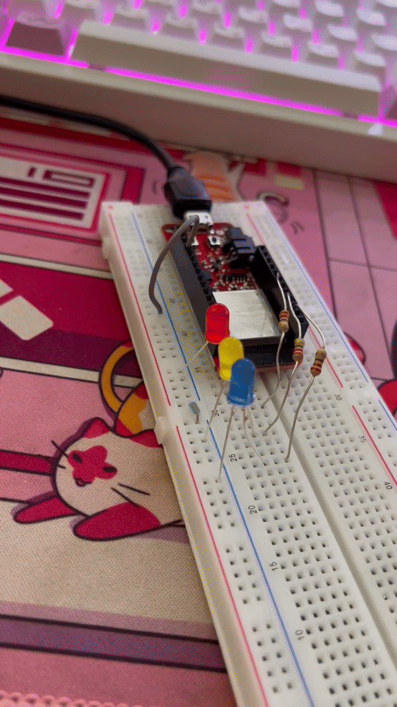
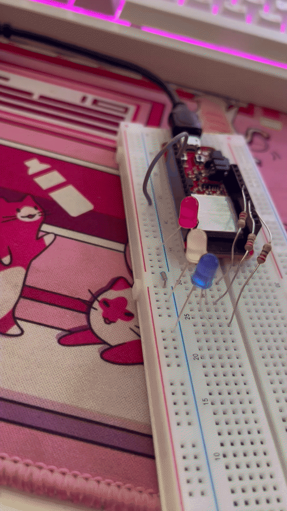
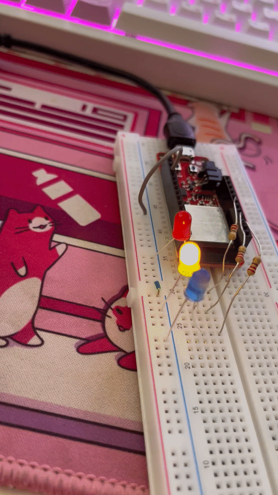
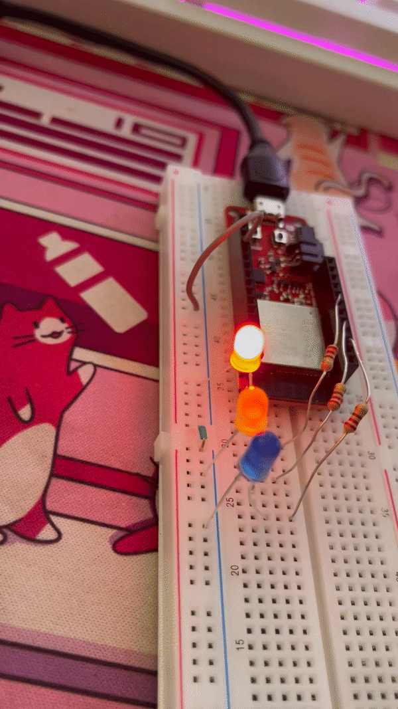
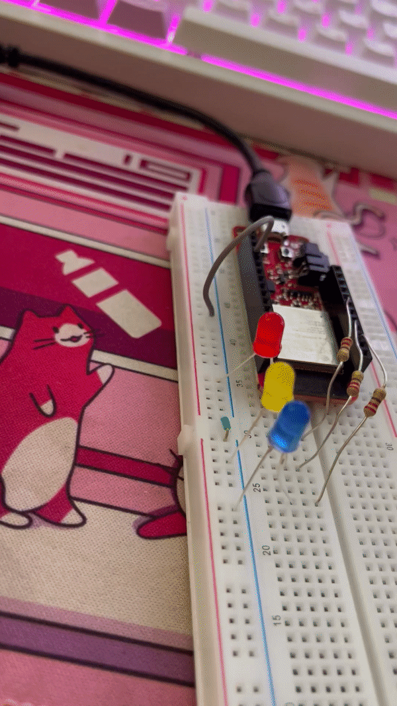
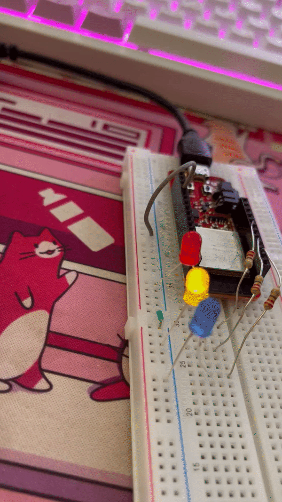

Jean Gorby Calicdan
A15955623

# Lab #2

# Tutorial Review
## Tutorial 1: Arduino Setup
I have worked with multiple arduino projects in the past so setting up the Arduino IDE was already done for me. I was told that my IDE was a bit outdated so I made sure to update to the most recent version and the UI looks a lot better. The Sparkfun ESP32 Thing Plus Board was new to me, however, and I learned from this tutorial that not everyting is simply plug and play. The tutorial did lay out the instructions on how to install everything necessary for us to be able to interface with it properly. I personally skipped the part talking about disabling boot messages since I personally wasn't bothered by it.

## Tutorial 2: Digital Communication
Digital communication is necessary for interfacing with circuit components that have HIGH and LOW states such as buttons and LEDs. I am very much familiar with the programming cycle when it comes to Arduino so the setup() and void(). Building the circuits needed for this tutorial was also a breeze as a veteran of the ECE 35 tutoring team (fun fact: I tutored ECE 35 when Girish took the class and now he's tutoring the class I am taking). From my experience, all of my arduino projects have involved blocking timings and not non-blocking timings which means this is my first time exploring the possibilities of non-blocking timings. Understanding the ```millis()``` function is the most important part of non-blocking timings and also the concept that took the longest to understand. ```millis()``` essentially keeps track of the amount of time that the arduino has been running since the code was uploaded to the board. In order to truly find time with it, we need a reference ```millis()``` at the start of the program call and compare it to any time we need. 

## Tutorial 3: Serial Communication
Serial communication is essentially a way to communicated with the arduino through a a stream of data rather than just the HIGH and LOW features of the GPIO pins. This form of communication is probably used the most in order to call the ```Serial.println()``` function for debugging as well as a form of a UI. In order to get it working, however, we must first begin by setting it up using ```Serial.begin("some baud rate")```. Printing is one way for us to write data into the arduino but we also have the capability of reading from it. It works very similar to printing but instead of us sending the data, we are receiving the data.

# Challenges

## Challenge 1: LED Blink Frequency
I had a few different ideas on how to ultimately implement this challenge. The first idea I had was to have all the LED's run at their respective frequencies using one single function which took in their on/off periods and pin numbers while using non-blocking timings but I struggle to implement this as I wasn't quite familiar yet with the ```millis()``` function. I then moved on to having at least a function for each one but still using non-blocking timings but, again, I suffered the same challenge. In the end, I went for the most basic implementation of having a function for each LED and used the ```delay()``` function in order to get the timings down. <br>
For the first 3 conditions, we were simply given a frequency at which the LEDs should turn on for. In order to use the current code that I had and make it more general, I calculated the period for each frequency. My code was generalized to have an ```int on_period``` and ```int off_period``` variables in order to account for the later 3 conditions. This means that as soon as I calculate the period, I must divide it by half and share both to the variables I defined. I used the function ```T = 1/f``` in order to find the period. I labelled these periods in the comments of my code.<br>
Here are the results of challenge 1: <br>

|  |  |  |
|----|----|----|
|  |  |  |

## Challenge 2: Stopwatch
My stopwatch begins in a standby mode where the program doesn't really do anything until a button is finally pushed. As soon as the button is pushed, the program goes into the start state where the true counting of time elapsed happens. If the button was clicked again within this state, the stopwatch then pauses. The way I have implemented the pause feature revolves around compensating for time paused rather than just stopping time altogether. I count the amount of time I have lost while the stopwatch is paused and make sure that this is subtracted from the elapsed time in the start state. In order to check if the button has been clicked for at least 3 seconds, I force the program into pause state in order not to get the program confused on "holding" down the button and "clicking" down the button. In this state, I use a while loop to check the amount of time that the button is held by. There is an if statement later down the line that checks if this time is longer than 3 seconds and then finally moves the program into reset state and transitions back into standby mode. <br>
In completing this challenge, I faced a lot of issues with fundamentally understanding the millis() function and how to fully operate with it. By the end, I was able to utilize but it was definitely a challenge. In working with the challenge instructions, we needed to only display the time after every 1 ms. Due to the nature of my code and the way the arduino operates, checking for this condition with non-blocking timings doesn't lead to nice numbers. I was originally going to check for <br>
```if(elapsedTime % 100 == 0)``` <br>
which is precisely every 1 ms, but by the nature of the Arduino and the amount of checks that it does, by the time it gets to this check it is probably past the zero mark. I compensated for this by instead checking for <br>
```if(elapsedTime % 100 < 10)``` <br>
to at least get as close to 1 ms as possible, while still maintaining reliable relay of the actual time. 

[Watch the video here](https://youtube.com/shorts/10VnraAKki0?feature=share)

## Challenge 3: Timer
I moved away from using a state machine for the timer as I found it easier to simply work the variables that I had. I start the program by simply telling me how much time is in the timer and the clicking the button increments this time by 1 each time. Clicking the button also resets a bunch of variables such as the amount of time since last click. This click is also related to the checking of how much time has elapsed since holding down the button to check if the user wants to reset. If this button was clicked for at least 3 seconds, the timer is simply reset. The updating of the timer is simply a check of all these variables and a quick and easy decrement. <br>
I implemented a similar way to check if the button has been held down for at least 3 seconds from the stopwatch into this program as well by using a while loop to check for this time. I also used a similar if statement to print out the timer as I can't exactly print it out every 1 ms to the dot. 

[Watch the video here](https://youtu.be/8IimI288-B8)