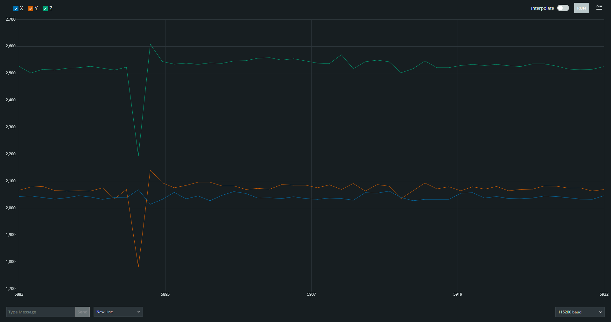
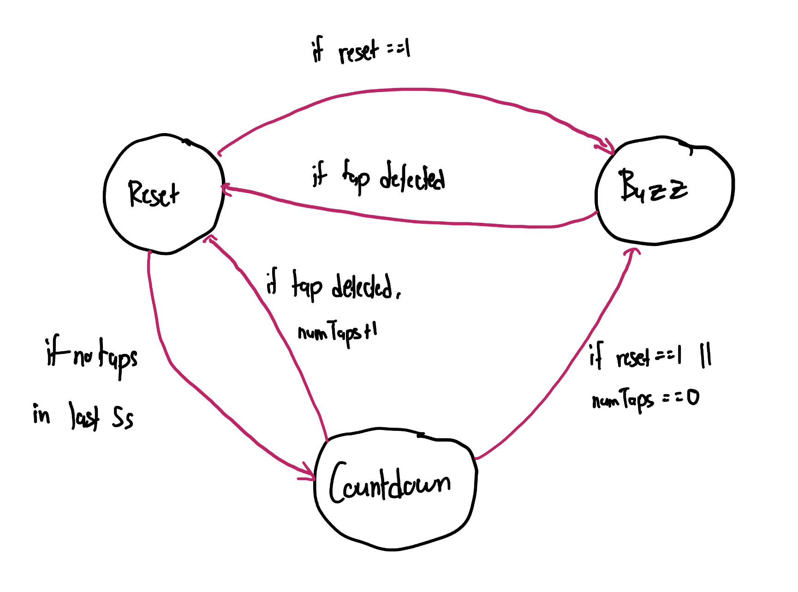

Jean Gorby Calicdan
A15955623

# Lab #3

# Tutorial Review
## Tutorial 1: I2C Communication & OLED Display
The OLED display is a great way for users to interface with the microcontroller rather than just relying on simply print statements. The OLED display we use for this course uses I2C communication, in which we include the Wire library in order to take care of most of it for us. Wiring the OLED screen is as simple as wiring any other components but it does use special ports on ESP32 such as the **SCL** and the **SDA** ports. In order to make the OLED display code modular, so that it can easily be ported over to future programs, it is necessary to create a new tab in which a lot of the setup and desired functions will already be taken care of. Displaying any text to the OLED screen is now as simple as calling the ```writeDisplay()``` function.

## Tutorial 2: Analog Input (Accelerometer)
An accelerometer is a sensor which exist in very many of the technologies that humans use in their day to day basis. The accelerometer we use is analog in the sense that it produces continuous data but in order to utilize, we must convert it to digital using an ADC. Depending on the resolution of the ADC, the output can be represented in may ways. In terms of wiring the accelerometer, it is pertinent that we use the analog ports in order to interface with each axis value. The values can then be displayed by printing them and utilizing Arduino IDE's Serial Plotter. Similar to the display, we created another tab to take care of the accelerometer to make it easier to use in future programs.

## Tutorial 3: Analog Output (PWM)
Pulse Width Modulation is a way to use digital values in order to produce an analog output. This is done by having an on/off cycle with varying frequencies in order to produce a sense of dimness. For instance, if an LED were to be turned on/off equally repeatedly, it gives the sense that the LED is about halfway turned on. In the arduino IDE, there are built in functions which help create PWM output which can be used for either LEDs or even buzzer motors. Like the two previous tutorials, a motor tab was created in order to modularize powering the motor with PWM.

## Tutorial 4: Sampling
Sampling is a way for us to make our lives easier when dealing with analog inputs because it allows for the digitizing of these massively varying inputs. Depending on how well we sample it, i.e. the sampling rate that we choose, one can operate on analog signals much less chaotically. A sampling tab will be created for this tutorial. The accelerometer from earlier is a great example of an analog input which can be sampled and analyzed. By taking the tabs from earlier and even integrating the OLED display, we can create a program that uses a bunch of technologies to accomplish a task cleanly.

## Tutorial 5: Python Serial & BT Communication
The ESP32 is entirely capable of communicating in many ways, two of which include communicating directly with Python and even through Bluetooth (or both!). The PySerial library will be needed in order for this to work. This library allows us to send and even receive data, essentially communicate, between Python and the microcontroller unit. Bluetooth works in a very similar sense but this time, we are not tethered by a wire connected to the computer that we are communicating with. It is important to distinguish within the sketch uploaded to MCU which method of communication we are using in order to not cause any confusion. This can be done by using precompiler directives such that we can simply change one variable in order to switch between the Serial or Bluetooth connections.

# Challenges

## Challenge 1: Gesture Detection
In order to detect taps, we must observe what it looks like when a tap is made within the serial plotter. <br>
 <br>
One can see that when a tap is made, the az values drop down significantly. One can also see the same value goes up when it bounces up. I have also found instances in which the value goes up rather than down when a tap is made. Therefore, I made sure to account for both without the possibility of double counting by creating a proper conditional statement for it. <br>
### Discussing Weakneses
- The algorithm fails when the breadboard is upside down although I was only testing while holding it up rather than setting it down. Setting it down might mitigate the change in acceleration while I am holding it up.
- The algorithm fails when the device is moving, especially vertically, as the algorithm simply watches out for the change in the z acceleration.
- The algorithm can respond to external vibrations as long as the vibrations are strong enough to reach the set threshold. I found it takes me to mash my table in order for it to actually get affected.
### Possible Solutions
- Figure out when there is movement and not take any inputs until said movement has ended. This could find issues when the user wants to make an input whenever they are moving but this at least solves the problem of movement affecting input. 
- A gyroscope sensor can be integrated with the device in order to detect changes in orientation. The program can compare current orientation with original orientation to see if it has moved so that it can still be used in any orientation.

[Check out the tap detection in action here](https://youtube.com/shorts/FIzBD2DCRss?feature=share)

## Challenge 2: Gesture-Controlled Watch
By building on from the previous challenge, we can now create a countdown timer controlled entirely by gestures. In order to begin this challenge, I create a finite state machine which will visualize how the code is structured. <br>
 <br>
*Note that ```reset==``` stands for when the machine is purposely reset.
As you will see in the video, I was able to implement every feature besides the reset functionality. I have some code within the file (commented out) that shows my approach and it was slightly working but had flaws. When I hold down on the accelerometer, I noticed that there wasn't a lot of change with the waveform, at least not as drastic as tapping. I wasn't sure whether this was intended but I rolled with it and analyzed the waveform. I noticed that holding down the accelerometer actually increases the average z-axis acceleration and I used this to my advantage. I imported the smoothing library which uses a sliding window in order to take the average of the previous 10 az values. I use this average to determine whether I was in the range of holding down the button or not. In hindsight, I could probably have made it work better if I had just increased the window size, but nonetheless, my biggest problem came down to timing and the transition between states.

[Here is a video of machine 90% working](https://youtube.com/shorts/nrFNVTuzIFQ?feature=share)

## Challenge 3: Wireless Weather Watch
Unfortunately, I didn't have enough time due to poor time management in order to delve deep into this challenge. I was only about able to get the first two features of the watch, the current time and date, implemented. I used the datetime module and used the datetime object and its attributes and methods in order to grab the time now as well as date now. I have them cycling one after the other within the watchface. <br>
If given more time, I definitely would have loved coming up with solutions regarding the whether and cycling through different locations but alas, lessons have been learned for the next lab.

[Here is a video of the unfinished watch](https://youtube.com/shorts/8Q7Zi0oO7q4?feature=share)
