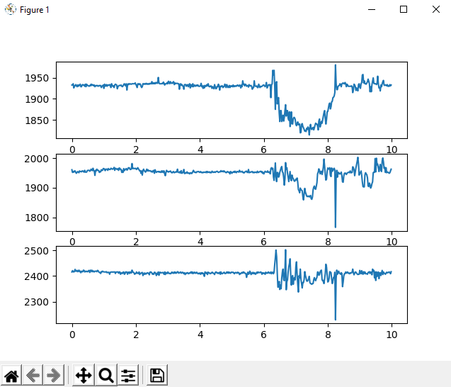
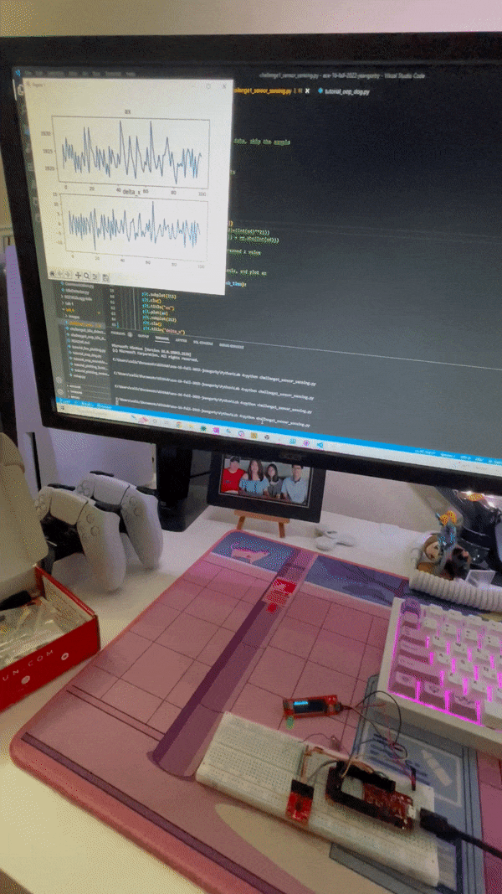
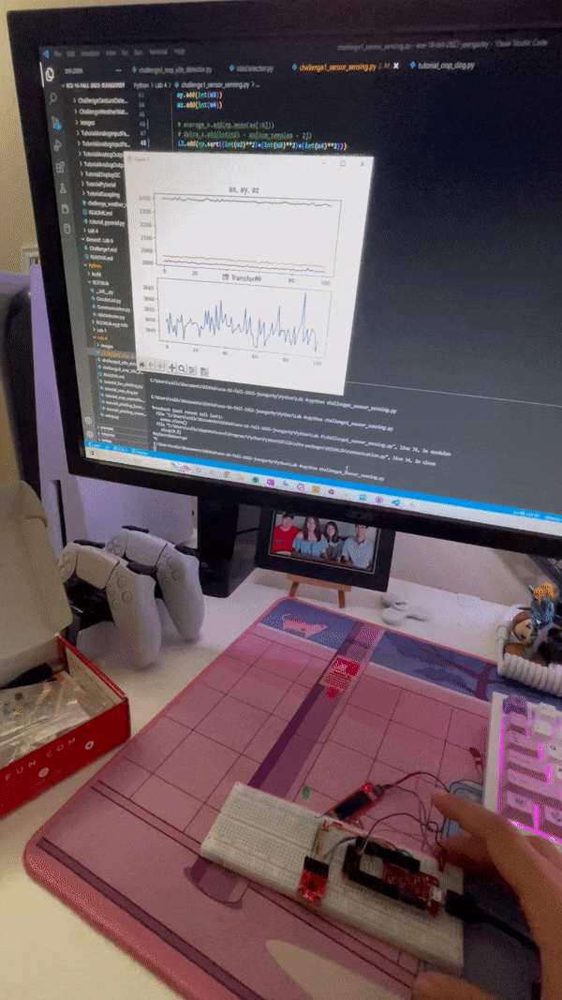
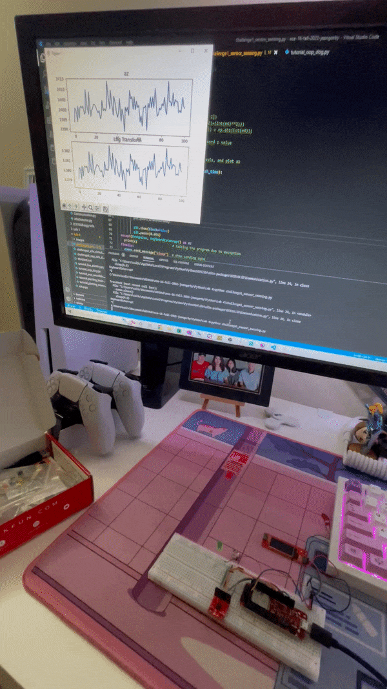

Jean Gorby Calicdan
A15955623

# Lab #4

# Tutorial Review
## Tutorial 1: Object-Oriented Python
Object oriented programming is a way to organize code in terms of classes and objects in order to create better readability as well as modularity for programmers. Objects are instances of the classes and these objects come with methods which are essentially functions specific to that class. The first half of the tutorial goes over how Python handles this OOP lifestyle as our knowledge and programming is tested. 

### Testing Your Knowledge

1. **Question 1** <br>
What is the output of the print(scout) statement? Explain it.
- ```print(scout)``` returns ```<__main__.Dog object at 0x00000261A49435E0>```
- This print statement tells us that ```scout``` is an instantiation of the class ```Dog``` as well as its location in memory. 

2. **Question 2** <br>
What would happen if we were to change the second print statement to print out the breed with print(scout.__breed)? Explain this result. What does this mean in terms of the Dog class and Object-Oriented Programming?
- If ```print(scout.__breed)```  were to be added, the program will throw an ```AttributeError``` telling us that ```AttributeError: 'Dog' object has no attribute '__breed'```
- The reason this error is thrown is because the ```__breed``` attribute is purposely encapsulated by the programmer. Encapsulation is a way for programmers to hide certain attributes within classes, for instance the ```Dog``` class, for several different purposes. 

3. **Question 3** <br>
At the end of the Python file, add a second Dog object named **skippy** and make **scout** and **skippy** buddies. Then use **scout** to print out **skippy’s** description.
```
skippy = Dog("Skippy", 3, "Poodle")
scout.define_buddy(skippy)
scout.buddy.description()

// prints: Skippy is a 3 year old Poodle
```
The second half of the tutorial discusses how we can create our own package which can contain classes that we have defined ourselves. This allows us to reuse code from earlier as well as allow it to be integrated into code in a much cleaner way such that a lot of the "dirty work" happens under the hood.
## Tutorial 2: Python Plotting
Python is incredible for computing (similar to Matlab) because of the many libraries it has which aids in math and visualizing. Matplotlib is one of the more well-known library for plotting in Python. <br>
Numpy and ndarrays can be used in tandem with matplotlib but it is important to understand how they work. For instance, in the following example:
```
a = np.array([[1,2,3,4],[1,4,9,16]])
plt.clf()
plt.plot(a)
plt.show()
```
the code prints 4 different lines where the first row values are taken as the start point and the second row values are the end points. This may be slightly counterintuitive to the eyes of the unexperienced but it is important to understand.<br>
For our case, we will be plotting most often the values that we get from the accelerometer. Luckily, it is as easy as recording values and plotting. We can specify for how long we want to record values and then plot these values using matplotlib.<br>


## Tutorial 3: Live Plotting
In order to allow the data we record to be more useful to us, it even better if we can see the data change in real time rather than just recording a few seconds of data. This is where live plotting comes and we can't do this without the help of a circular list.<br>
A circular list essentially acts as a First-In-First-Out(FIFO) buffer which is essentially a serial register or a queue. Whenever a new data is received, assuming the list is full, the new value is placed at the end of the list and then everything is shifted to the left.<br>
To make our lives even easier, circular lists will be made availabled as a class which is present in the package we started earlier. Note that this class inherits from Python's List class, one that we have worked extensively before, which means we can use familiar methods and techniques when working with them. <br>
In order to plot the data in real time, it is is fairly similar to plotting it regularly but we must put some limitations in order to ensure performance such as limiting the refresh rate and making sure we don't get corrupted values. The plotting also happens within a try/except/finally clause in order to allow users to interrupt with their keyboard so that we can easily stop live plotting. 

# Challenges

## Challenge 1: Sensing the Sensor
Often times, simply reading raw datas such as raw acceleration values limits what we can do in terms of different tasks. For instance, differentiating between activity and a button press and practically impossible when just reading raw values. This is where transformations come into play so that we can manipulate these values and learn different things from it. <br>

The transformations that will be performed for this challenge are as follows:<br>
1. The average of the last N raw ax values, ```average_x```
2. The difference between the current ax value and the previous one, ```delta_x```
3. The sums of the absolute values of all 3 axes ```L1-Norm```
4. The Euclidian distance of all 3 axes a.k.a. the ```L2-Norm```
5. The base 10 logarithm of the raw az values ```transformed```

Here are the results: <br>
|  **average_x** |  **delta_x** |  **L1 transform** |
|----|----|----|
|  **L2 transform** |  **Log transform** |

### Discussion
1. What value of N gave you a smoothed version of the acceleration without completely flattening the signal?
- I found that the value, N = 70 gave me quite a smooth version without completely eliminating subtle characteristics.

2. Are there any advantages of using an L1 or L2 norm instead of the acceleration along just one axis?
- In testing this norm transforms, I found that they sort of unify all three axes in the sense that, when one moves all axes at onces, it creates a new plot that can be better analyzed. I think that this can come into play when integrating bigger user movements when the user is actually wearing the watch on their wrists and are using it from an hour to hour basis. I find that simply reading raw acceleration values makes it hard to distinguish these cases.

3. Did the transformations help you see something or understand the data better? This is a subjective answer, but we want you to take some time thinking it over.
- I actually found a way to distinguish between a button press and simple activiy with the use of these transformations. This was something I struggled with in lab 3 because it was so easy for the accelerometer to detect a movement as a button press when it wasn't intentional. I found that using the average transform together with delta transform allows one to distinguish between the two. Typically, button presses creates a much larger delta value as opposed to when you are simply moving the accelerometer around. This distinction can be taken advantage of in future programs. 

## Challenge 2: Idle Detector
It is now time to put all of this together and create a functioning idle detector using Python and the Arduino <br>

The program begins by initializing certain variables, most importantly the CircularLists which will hold the raw and transformed data values from the accelerometer. A bluetooth connection is then created between Python and the Arduino in order to begin streaming data. The general flow of the code follows this state machine that I have drawn up:
<br>

I have split the code between Python and the Arduino such that I have Python taking care of all of the timings as well as data evaluation while I have Arduino taking care of all the states and state transitions. I do this by simply sending a command which states whichever state the idle detector is currently in. <br>

In order to detect a button press, I utilized the delta_z transform and set a threshold of 100. I use this line of code to detect when it happens: 
```if(any(i>100 for i in delta_z)):```
Note that I check the entire CircularList for the value due to the nature of how I evaluate these data. I sync it with the refresh rate of the plot (if I do decide to plot at the same time, for the final code, I have them commented out). To compensate for "debouncing" since the if statements will trigger as long as this threshold is met within the list, I clear the list so that new data is streamed in.<br>

In order to detect activity, I utilized the average_x value as sort of a proof of concept for this lab. I can easily account for any and all of the axes to define "activity" but since this is left for ambiguity in the lab, I simply ran with the average of x to show that it works. I use a similar logic from the button press but I don't clear since I didn't think it was too necessary to account for overactivity as show in the video, it works. <br>

The rest of the code is simply checking for how long the user has been inactive and sending the appropriate commands depending on how long the inactivity is. <br>

[Check out the Idle Detector in action here](https://youtube.com/shorts/aKK3-xT6Y3g)

## Challenge 3: OOP Idle Detector
In order to translate the Idle Detector code into a class, it is important to understand that both programs should work the exact same way with the only difference being the organization of the code. <br>
I decided to split up the bigger functionality of the code into the following methods:
 1. ```__init__(self)```
    - This method comes with all the classes but I took advantage of this to declare attributes/variables that I will be using throughout the program.
 2. ```run(self)```
    - **run()** literally runs the entire program and uses all of the helper methods that I defined below. This follows a lot of the same logic that I used in the previous code.
 3. ```startCommunication(self)```
    - Establishes the connection between Python and the Arduino. This function also initializes the state machine by sending the "off" command. This function also returns a Communication() object which will be used in other methods
 4. ```closeCommunication(self, comms)```
    - Closes the connection between Pytoh and the Arduino at the end of the program.
 5. ```collectData(self, comms)```
    - Receives data from the Arduino. Also responsible for making sure the data is not corrupted. If not corrupted, then this data is added into their respective CircularList objects as well as are transformed and inserted into necessary CircularLists.
 6. ```def checkButtonPress(self)```
    - Responsible for checking if the button has been pressed. Returns a boolean on whether or not the button has been pressed. Utilizes a transform CircularList by referencing to the attribute in order to do its task. Also updates the **on** attribute which updates the state machine. 
 7. ```def evaluateData(self, inactivity, current_time, time_inactive, comms)```
    - Takes the data that has been received and collected by the other methods and interprets it. If the **on** attribute is True, this means that the Idle Detector should be on, otherwise it is off. Checks for user activity by checking the average_x attribute and updates the state machine accordingly. Also checks for user inactivity in order to send proper commands, if user is indeed inactive.
 8.  ```plotData(self)```
    - Plots the data that is streaming from the MCU in their transformed forms. 

### Discussion
1. Identify any weaknesses in your algorithm for idle detection. <br>
    a. What improvements could you make for each of these weaknesses?
    - There can still be some work done with the timings in order to make sure that every tap is recognized as a tap and isn't skipped or ignored. This one simply comes down to more trial and error but at its current build, it is very reliable. 
    - Distinguishing between different gestures is still something that can be worked on. It is still entirely possible to mistake a button press as user activity or vice versa, albeit much harder now than before when we were simply working on the arduino. This can be fixed by integrating more transformation and more axes. 

2. Compare the code you wrote in Challenge 2 with that in Challenge 3.<br>

    a. Which one did you think was easier to write?<br>
    - I personally found it harder to write the IdleDetector class as opposed to the simple idle detector python file. This personally comes down to my experience with organizing and thinking in terms of this OOP paradigm as it was very weird to think of reorganizing tasks in terms of different methods and having attributes rather than simply variables. Near the end however, it got much easier to understand the inner workings of a Python class and how it is written.

    b. What are the advantages and disadvantages of each approach?
    - Writing a class allows for much wider versatility and modularity, especially in the future when we want to utilize the same logic for a different code. It is fairly typical for programmers to go back to their code and expand upon and/or utilize in some way in other projects. Organizing the code into a class allows this without rewriting the code.
    - Debugging is definitely supremely better when not working with the OOP method. I found that VScode does not specify which lines the errors occur in when working with an object since the work happens "under the hood". This made debugging much more time consuming. Not to mention the part that increased this time much more significantly. Updating the class Python file wasn't enough to make changes. One must reinstall the library in order to see these changes reflected in the code. If a professional were to work on it, they would also likely change every version number whenever they would update which is a massive time sink as opposed to simply working on one Python file. 

[Find the working OOP Idle Detector here](https://youtube.com/shorts/ZFLUT4eIfyo?feature=share)


