Jean Gorby Calicdan
A15955623

# Lab #4

# Tutorial Review
## Tutorial 1: Offline Data Analysis
In order to analyze data, the data must be in a form that the programming language can read from. Comma-separated values or CSV files are common in data analysis as it allows for congregation of values all within one file. Numpy allows programmers to both save and load these CSV files with ease. <br>
This tutorial goes over how one can record data and ultimately save it into one CSV file. The main code allows users to start a 10 second window of data gathering and save this data into a CSV file. <br>
Here is one set of data that I have gathered with the graph partitioned into each step taken: <br>


## Tutorial 2: Digital Signal Processing (DSP)
Digital signal processing is a process and taking signals and data and transforming them in order to obtain data is much more readable, understandable, and easier to analyze. The reason this is done is because, oftentimes, real time raw data is not the greatest as it can be noisy. <br>

### L1 Norm
Since we are working with 3 dimensions when it comes to working with the accelerometer, it is important to unify this data into one single piece of workable data as it would be too taxing to work on each dimension individually. All pieces of data from now on will be analyzed with the L1 Norm considered from the get go.

### Moving Average Filter
Due to the noise that is brought up earlier, it can often be misleading to read data and notice that there are a lot of bits that are unimportant. The moving average filter, like its name suggests computes a moving average through the given data. This makes it so that the figure ends up looking much smoother.

### Detrending
Since the accelerometer is affected by all three axes, an effect that can come from this is the effect of gravity affecting the device as we move it around. Detrending is a method which uses the previous defined filter, the moving average filter, in order to remove this gravity effect. Here is an example showing the data becoming more centered near the middle in order to essentially remove the effect of gravity: <br>
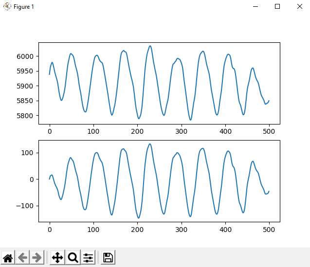

### Gradients
Gradients are the first step into detecting peaks within this data. As we know from calculus, the derivative at a peak will be zero. Gradients allow us to see where peaks occur by checking where the the data crosses zero. Here is the gradient in action: <br>
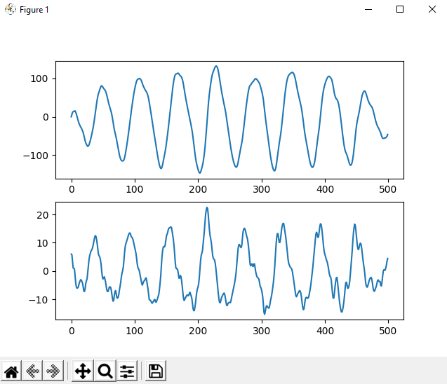<br>
It is noticeable that the gradient makes the signal noisy again. This may be a case of the data having changes in rate of change. As we know, the derivative is essentially a measure of how fast a signal is changing. I would guess that the signal has some micro changes in speeds that may not be noticeable originally.

### Power Spectral Density
This is one of the first steps into getting into the frequency domain. The power spectral density shows us the power distribution of the signal within the frequncy domain. By looking at the psd, one can see at which frequency most action is occuring.<br>
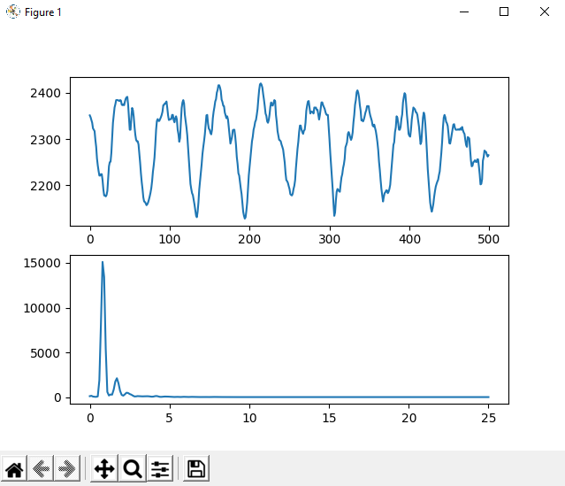<br>
**Important Questions**
- If the sampling rate was 120Hz, the maximum observalbe frequency component would be 60Hz, which is also the Nyquist frequency.
- If the signal bandwidth is composed of 0-10Hz, it would be recommended to use at least 10Hz to sample it according to the Nyquist Sampling Theorem.
- In general practice, it is recommended to go above this minimum requirement.

### Low-pass & High-pass Filtering
The moving average filter from earlier is a kind of low pass filter but isn't quite the greatest due to it being a weak Finite Impulse Response filter. A real low-pass filter would do a greater job at removing the higher frequencies as the moving average filter was attempting to do. <br>
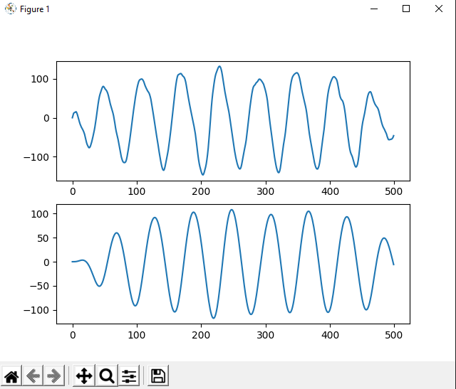 <br>
The low-pass filter succeeds in smoothing out the original signal much better than before. A problem arises, however, since the signal is now shifted horizontally and a flat value exists at the beginning, which is called the filter transient. This can be solved by essentially filtering the signal a second time in order to eliminate these two problems. <br>
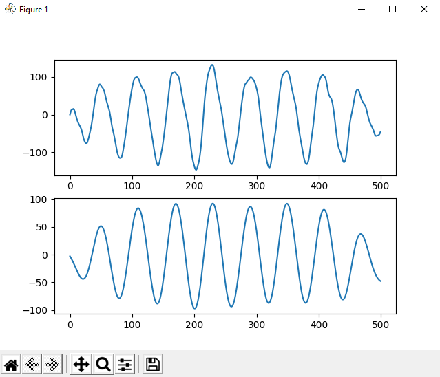

### Post Processing
This is the part after cleaning up the signal where we can finally extract useful information from the data. For our particular use case, finding peaks within our data is doing to be the most important part as these peaks ultimately represent activity. Scipy has a great function which makes this trask fairly trivial as long as we provide it our own thresholds.

### Modules
With all these DSP techniques that we have learned, creating a module will allow us to reuse a lot of these functions without ever having to redefine them. Their implementation and functionality is similar to that of a class but we dont have to instantiate objects for them, which is convenient, but also makes sense.

## Tutorial 3: Pedometer Class
The pedometer class will be incredibly useful for detecting steps as well as other similar capabilities later on. The class itself has three methods, two of which serve as a way to add data and reset, with the third one, ```process()``` being its most important one. This method will take care of all the processing required in order to return the number of steps a user has taken. The fact that this was implemented as a class method also allows the programmer to effectively tweak this as they desire in order to achieve better results without rewriting any code.

# Challenges

## Challenge 1

### YouTube Video Links:
Steps predicted on online Jean Gorby data: https://youtu.be/ROnRcIuwRpY

Steps predicted on online Haozhang data: https://youtu.be/l8FVqOhoHv0

Pedometer counting steps real time: https://youtu.be/Rc84JXiVhHo

### Task Description:
Challenge 1 challenges us to take the Pedometer class started in the tutorials and complete it in order to create a more reliable step counter. This challenge allows for real time data gathering and processing in order to display steps as soon as they are taken, as shown in the video. The general logic follows that Python sends a message that it is ready to receive data and the MCU will do just that. Python then utilizes the completed Pedometer class in order to process the incoming data and update the display. 

### Processing Algorithm:
AX, AY, AZ >> L1-Norm >> Moving Average >> Detrend >> PSD analysis >> Cutoff calculation >> Low-pass filter creation >>
Low-pass filter >> Gradient >> Moving Average >> Detrend >> Scaling >> Count Peaks

### Algorithm Explanation:

| 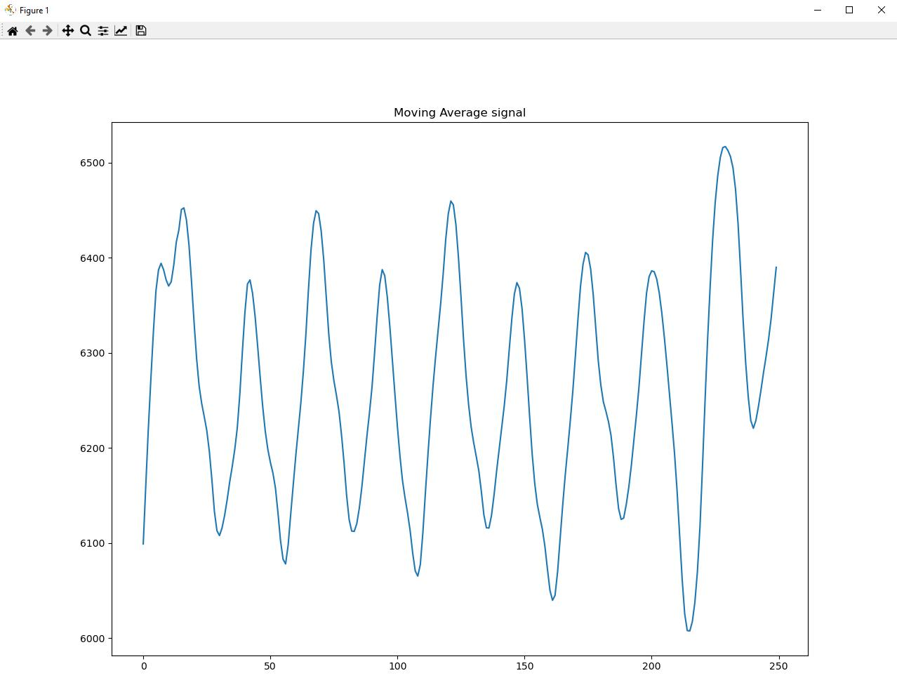 | 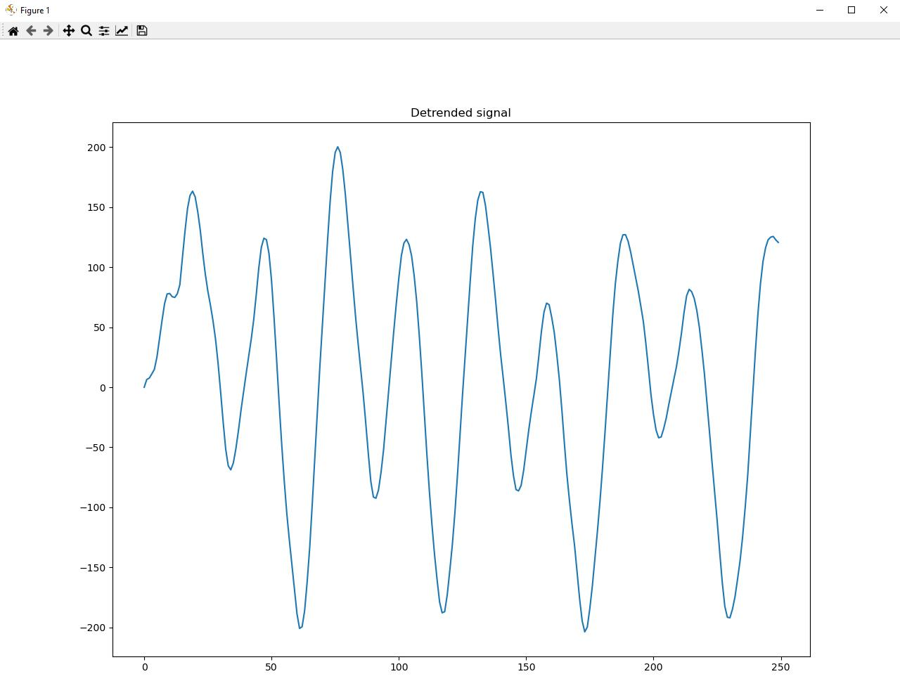 | 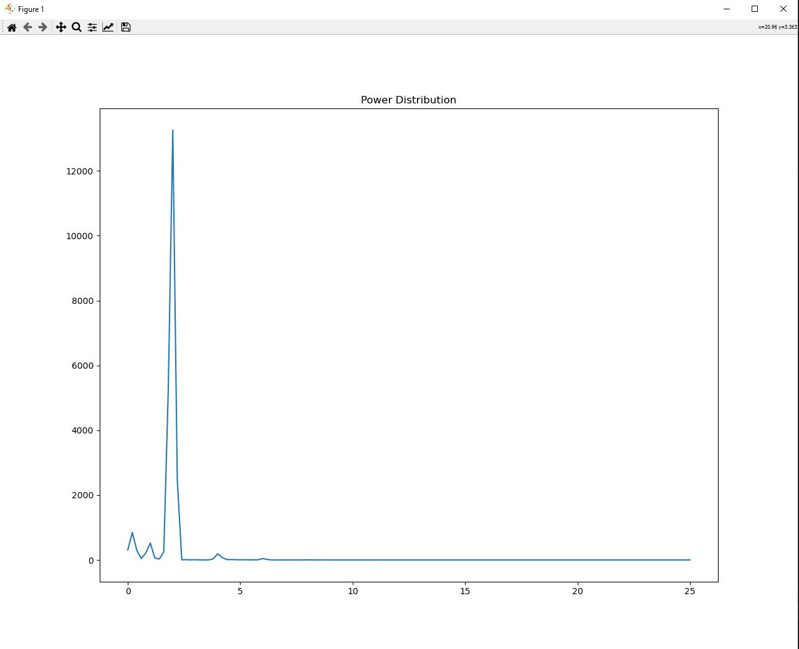 |
|-----------------------------------------------------------|-------------------------------------------------------|---------------------------------------------------|

| 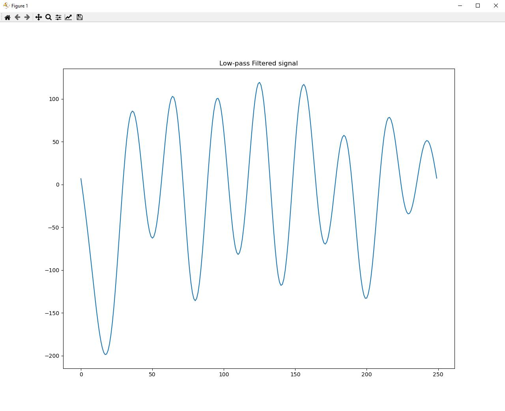 | 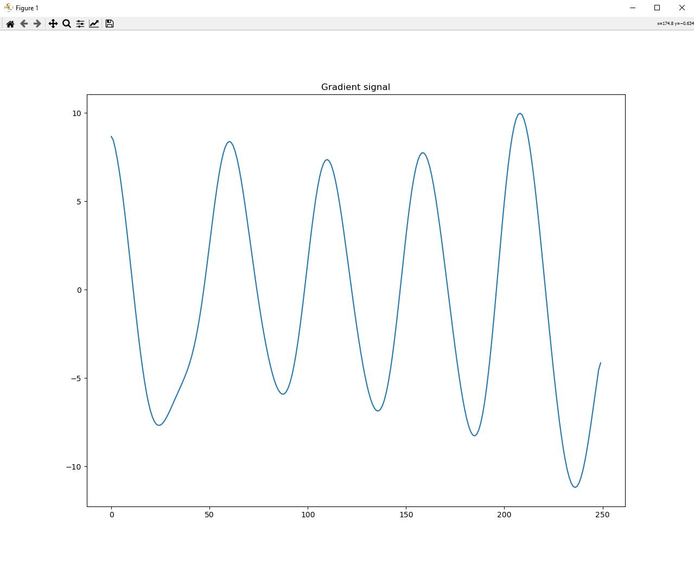 |  |
|-------------------------------------------------------------|-----------------------------------------------------|---------------------------------------------------|

The algorithm provided by the tutorial was a great start but was ultimately not the most reliable and needed some tweaking. It follows a fairly similar flow at the beginning where the AX, AY, AZ values are collected from the MCU and these are used in order to calculate the L1-Norm. This data is then used in order to calculate the moving average in order to smooth this signal for the first time. Detrending serves as a way to extract drift as explained in the tutorial section. <br>
The PSD analysis and how it is used is where our program begins to differ from the tutorial. The power spectal density will be used in order to filter out walking frequency and eliminate higher noise frequency in order to ensure that the data isn't disturbed and misled. A cutoff frequency is calculated by finding the peak in the PSD in order to realize what the frequency of the walking is. This value is used with an additional 10% for some leeway, but also allows for adaptation to differing walking frequencies, depending on the person. <br>
The low pass filter creation is there in order to create necessary filter constants which take into account the new cutoff frequency. This filter will be used in order to gain a clearer signal as usual. Something different we do as well, is use the gradient step a little later into the process. We take the gradient, perform the general smoothing process in the beginning, and then use this signal in order to find the peaks. The signal is scaled up by 10 for the purpose of making it easier to observe the peaks. Finally, the find peaks function is used in order to finally retrieve all the steps based on the defined lower and upper threshold.

## Challenge 2

### YouTube Video Links

Step vs Jump Algorithm: https://youtu.be/0tMdGp0yPFI 

Route with 2 steps: https://youtube.com/shorts/tDp2HHsb_sM?feature=share

### Task Description:
In Challenge 2, it was asked to expand upon the pedometer to not only count steps, but to also count jumps. For this particular challenge, a very specific logic flow must be followed. First, the MCU must have initialized some data structure in order to act as a buffer for data. We used the **CircularBuffer** library within the arduino and initialized three of these, each with a size of 256 elements, in order to store all three accelerometer values. Once the MCU is connected to Python (by running ```challenge2_activity_recognition.py```), the MCU begins collecting data and storing it in these buffers. With our configuration, the MCU is sampling the accelerometer at 50Hz, which means that these buffers represent around 5 seconds worth of data. Afterwards, the user must click a button in order to send this data to Python in order for it to be analyzed. Python utilizes the modified Pedometer class in order to detect steps and jumps, as well as differentiate between them. After processing, the Python sends a message back to the MCU to update the step and jump count displayed on the OLED. The cycle can be continued again as the MCU will go back to collecting data and waiting for another button push.

### Algorithm Explanation
The algorithm used for this challenge is the exact same as the one used for challenge 1 with one major change. In order to establish whether a peak is a step or a jump, a different low and high threshold must be set for jump. Since there are three major activities i.e. no activity, step, or jump, the first two were already taken into account from challenge 1. Jump simply meant that the values exceed the threshold for step. <br>
Here is an image showing a plot of how a step is differentiated from a jump with the lines representing the set thresholds. <br>
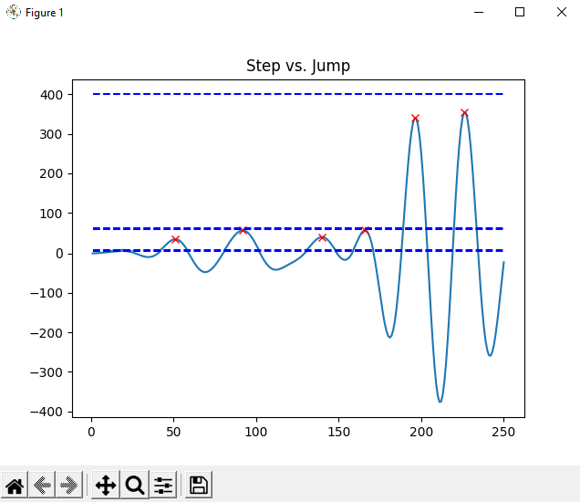
