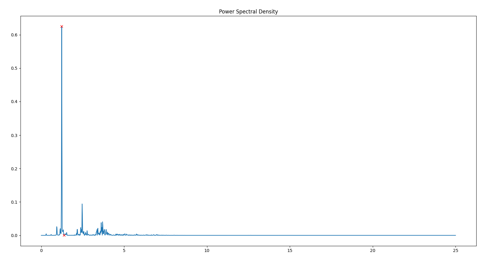

Jean Gorby Calicdan
A15955623

# Lab #6

# Tutorial Review
## Tutorial 1: Photoplethysmography
Photplethysmography, which I am now convinced is a real word, is a form measurement involving light and volumetric changes. At the core level, it seems that it is a quick measure of the relationship between how much light you shine in and how much light you get back. This can be analyzed even more in depth as you start considering different wavelenghths of light. <br>
For our purposes, we will begin by using a MAX30101 Photodetector which does a lot of the job for us. The board has a built-in red, green and infrared LED's that will be used in order do photoplethysmography. The circuit set up is extremely similar to how the OLED screen is wired, in fact the exact same, so using rails in order to connect both was necessary. <br>
This board is amazing and it can be implemented fairly quickly. <br>

### Testing Your Knowledge

1. **Question 1** <br>
Note that you can connect both the heartbeat sensor and your OLED at the same time, both of which use the I2C, SDA, and SCL lines. Why does this work? <br>

 - I2C communication is one that uses the the master-slave protocol (really need to change that name), wherein one master can have multiple slaves (wow thats really bad). In order to distinguish from from one slave to another, the message sent to the master by each device is structured differently. Within the message, there will be an address bit, which tells the master which device its receiving the message from, and then there is the actual message, which is whatever the device wants to tell its master. 

2. **Question 2** <br>
Notice the while(1) statement. What happens if the device is not connected? What happens if the error is printed and then you connect the device? Will the code proceed? Try it and describe the behavior.

- The while(1) statement is a shorthand for 
```python
while(1){
    "do nothing"
}
```
which is a forever loop with no way to interrupt besides booting it off. This means that if the device is not connected, the arduino will be stuck here for the rest of its lifespan until the arduino is restarted. Even if you were to connect the device in the middle of the loop, it will remain stuck because the arduino is doing nothing within this loop.

3. **Question 3** <br>
What would the settings look like if you were to: set the led brightness to 25mA, use only the Red + IR LEDs, sample at 200Hz, and use an ADC range of 8192?

- Here is the code:
```python
byte ledBrightness = 0x7F;        //Options: 0=Off to 255=50mA
byte sampleAverage = 8;           //Options: 1, 2, 4, 8, 16, 32
byte ledMode = 2;                 //Options: 1 = Red only, 2 = Red+IR, 3 = Red+IR+Green
int sampleRate = 200;             //Options: 50, 100, 200, 400, 800, 1000, 1600, 3200
int pulseWidth = 411;             //Options: 69, 118, 215, 411
int adcRange = 8192;              //Options: 2048, 4096, 8192, 16384
```

4. **Question 4** <br>
What are the units of the pulse width? Would the bigger pulse width result in a more intense or less intense measurement (intensity refers to the intensity of light)? Why?

- The units for pulse width is in microseconds. The pulse width is directly related to the sample rate as well as ADC resolution. The greater the pulse width, the greater the resolution of the ADC, but in term the sample rate is limited to lower values. A bigger pulse width will result in a more intense measurement, due to a bigger range of ADC values, but at a smaller sample rate.

5. **Question 5** <br>
How many bits are needed for an ADC range of 16384?

- We would need 14 bits in order to get an ADC range of 16384 (2^14=16384)

6. **Question 6** <br>
What is the peak wavelength of the R, IR, and G LEDs?
- RED = 670nm
- IR = 900nm
- Green = 545nm

7. **Question 7** <br>
If you want to read the green value, what ledMode do you need to set and what function will you need to use to get the green signal (HINT: it is not getIR()!)?

- If we want just the green value, the ledMode must be set to 3 and we would have to use the .getGreen() function.

As with previous new circuit components introduced in other labs, the Photodetector will get its own Photodetector tab so that it can be used in the future with ease. The tutorial goes even further by providing arduino code which can be used to utilize this new Photodetector class. In taking the code, I was able to get good solid readings at a stead ~49.7Hz <br>

As we are used to by now, Python always comes in to play and it is important that we still know how to make Python talk to the arduino so that we can get have more fun with the data that the photodetector sends us.

## Tutorial 2: PPG Filtering & Class

As with the pedometer, the photodetector data can be represented as a signal which we will refer to as ppg signal. In order to fully delve into this data and understand what it means, the same principles of signal processing to filter and clean it up. <br>

The general approach for this implementation of PPG filtering follows as such:
1. Detrending
2. Moving Average
3. Gradient
4. Normalization
5. Thresholding
6. Computing the Heart Rate 

Most of these are methods we have learned before. The new face in town this time around is normalization but it is as simple as dividing all the elements by the maximum value in order to get every value between 0 and 1. This makes it easier to analyze the data. Computing heart rate is unique for this scenario as previously counting peaks (to represent steps) isn't quite enough. The calculations that need to be made involve taking the average of the difference of the peaks (average beat time) and taking this number to divide 60 by. <br>

As foreshadowed by the fact that this is all similar to the pedometer, the HRMonitor will also get its own class so that it can easily be transferred over to any piece of code we want to use it in. The class, as it stands at this time of the lab, is fairly basic and uses the outlined DSP here, thus it will require tweaking and adding on to.

## Tutorial 3: Data Collection for ML
The easiest and hardest tutorial of all time, "Data Collection for ML". Recording heart beats is easy enough, but getting good and clean data, along with the pressure that this data will be used by other students in the class makes it very difficult to perform. <br>

The process for recording the data is simple, we keep our fingers tied to the photosensor for a solid few minutes. The placement of the finger must be consistent the whole time and must not leave the sensor for too much as it could result in a massive jump. It is also crucial to not have too many devices nearby as they can interrupt with the reading. <br>

I did multiple trials, with multiple scenarios and saved the best looking data so here is some context for the best chosen trials.

- Trial 1 and Trial 4: Practically at rest. This was part of making sure that I was getting good data so I took the first two official ones as just me trying to find the correct consistency with recording. 

- Trial 6: Took a couple a couple sips of coffee and it seems apparent my heart rate definitely increased.

- Trial 8: Took the elevator down from the ECE tutoring center, walked all the way to PC, walked back to Jacobs hall, took the stairs to the second floor, took the elevator to the 5th floor, and while in the elevator performed some jumping jacks. It is very clear that the heart rate significantly increased.

- Trial 10: Took my heart rate while listening to some depressing music. I do not know if it was placebo or not but I got good data while recording my heart rate so maybe the depressing music did play a role. 

# Challenges

## Challenge 1: Heuristic Heart Rate Monitor & Evaluation

### Task Description:
For challenge 1, we must build on the HRMonitor class that was provided to us in the tutorials and improve it to make for a more robust heuristic heart rate monitor. The goal for this challenge isn't too different from what was achieved with the previous tutorials, but this now, we will have a more concrete way of evaluating whether the algorithm does well. A correlation plot and a Bland-Altman plot will be our way to deducing whether or not the readings made by the class truly matches the actual readings provided by the user. This becomes a great tool in figuring out where the algorithm is still lacking.

### New Processing Algorithm

Invert PPG Signal ⇒ Detrend ⇒ Smooth (Moving Average) ⇒ Gradient ⇒ Normalize ⇒ PSD Analysis ⇒ New Cutoff Threshold Calculation ⇒ Low Pass Filter Creation ⇒ Low Pass Filter ⇒ Detrend ⇒ Smooth (Moving Average) ⇒ Gradient ⇒ Normalize ⇒ Compute Heart Rate

### Explaining the Algorithm
PSD             |  Heart Rate
:-------------------------:|:-------------------------:
  |  

This algorithm is heavily inspired by the step counter algorithm from our previous pedometer class with an important distinction created. The general flow starts the same as the previously provided algorithm where we detrend, calculate the moving average, get the gradient, and then normalize. These steps are crucial as it makes the following analysis easier to perform. We go back to the frequency domain for a more robust analysis of the users heart rate. Similar to the pedometer class, we get the power spectral density of the waveform and spend some time here analyzing. It starts off the same by finding the highest peak within this domain. This highest peak tells us at which frequency the heart is beating in the most. The most **important** change that was made between our pedometer class and the heart rate monitor, is that instead of simply taking this max frequency and adding 10 percent of it to serve as the threshold, we now have an algorithm to smartly calculate our threshold for us. In the pedometer class, since we were only tasked with counting steps, it was fairly easy to see that the variance in frequencies while walking was quite small so it was easy for us to simply do 10% of the max frequency as our low pass filter threshold. When calculating heart rate, there is a wider range of frequencies that are at play since we can account for users taking their heart rate after an exercise or while just sitting down. In order to account for this wider range of frequencies, we still find the frequency at which the most power is present but this time, we calculate the at which frequency the next minimum is. This allows the program to adaptively always get the best frequency in order to cover for the varying range in frequencies. This can be seen in the image above as the max peak is marked with a red x and the closest minimum to it is marked with another red x.

### Evaluating Performance
In order to evaluate the performance of the algorithm throughout different trials and date, we plot the resulting correlation plot and Bland-Altman Plot.
 <br>
We can see from the correlation plot that the correlation coefficient is really good. It is a bit odd to see an outlier up at the tope right but this was simply due to the fact that this was the only piece of data which reached an incredibly high heart rate. By looking at the Bland Altman plot, it is clear that the readings stayed relatively close to the mean, with the same data point from earlier driving the upper bound a bit high, but its reading makes sense regardless.

## Challenge 2: Online Heart Rate Monitor

### YouTube Video Links:
HC_Heartrate: https://youtu.be/0FWiv8qmFvc

HC_idle: https://youtube.com/shorts/7G39ZfEjw9g?feature=share

JGC_Heartrate: https://youtube.com/shorts/IACj6n20HvU?feature=share

JGC_idle: https://youtube.com/shorts/nShWeSxuD58?feature=share

### Google Drive Link:
https://drive.google.com/drive/folders/1t-VrWbE1R1XuhaZbmVZhG3NSt5TG1QP7

### Task Descriptions:
In this challenge, we are tasked to build a real time heart rate monitor which builds on from the previously improved upon HRMonitor class. This program is similar to that of the real time step counter we used in the previous lab but with obvious changes to adapt to the heart rate feature. On the Arduino side of things, the previously standard code of sending data and receiving data is reused, but this time we are not sending PPG data rather than pedometer data and such. This change was fairly simply allowing for Python to now receive PPG data. On the Python side, Python will handle establishing the connection between it and the Arduino and receiving this data. An HRMonitor object will be instantiated in order to handle taking in and analyzing this data. This is topped off by sending the calculated heart rate for the Arduino to update its display.

> Note: The time must be converted from ms to s and set to start from 0.

> Note: The HRMonitor class need to take care of the case when no finger is placed on the sensor. 

## Challenge 3: OpenCV Heart Rate Monitor
This challenge is a very close match to the previous challenge, just this time, instead of using the photodetector board that we spent a good amount of time with, we will now use our webcam. <br>

In order to use our webcam, we must first understand how to interact with it through Python and do all sorts of fun stuff. Welcome to the first ever tutorial within a challenge in ECE 16. <br>

OpenCV is one of the most fun and frustrating things to learn in Python but is so crucial for a lot of applications such as computer vision. In order to get started with OpenCV, we must first allow it to access the webcam by straight up opening a video feed from the webcam. With this, we now have video and we can do whatever we want from it. In fact, I took this opportunity to take a video of myself while OpenCV was performing canny edge detection. Enjoy this wonderful gif. <br>


> Side note: the gif that Ramsin placed on the challenge document is a thing of my nightmares

So how can we turn the webcam into its own PPG generator. It is as simple as, placing our finger tips on the camera itself, and allowing OpenCV to analyze it with the intent. We can take the RED channel of the video feed and take a look at how it changes over time. We are essentially performing some Photoplethysmography. <br>

To generalize it ever more so that we can find our heart rate, we can plot the signal with relation to time. This can be done with Matplotlib and some time functions. Here is an image of my heart beating: <br>


> This is around 60 BPM

Back to the challenge, the difficulty with translating from the Photodector board from the arduino to a webcam, is that the data is inherently different. The magnitude of the red values for instance are not at all the same, with the Photodetector able to read a much wider range of values. It is pertinent that the values across both be consistent. In terms of the ppg readings, this one didn't need much tweaking at all as the signal processing we have created generalizes fairly well with any magnitude of data. The biggest challenge was ensuring that the time sampled also makes sense in the context of the HRMonitor class. We need to make sure that we are scaling it correctly as well as making sure it is updated real time using Pythons time functions. 

[Check out the working webcam HR monitor here](https://youtube.com/shorts/8mMSu-u9tbU?feature=share)