Jean Gorby Calicdan
A15955623

# Lab #7

# Tutorial Review
## Tutorial 1: ML Data Preparation

## Tutorial 2: GMM HR Monitor

# Challenges

## Challenge 1: GMM Performance

### Task Description
Now that we have created an actual machine learning model using a Gaussian Mixture Model, it is now time for us to evaluate its performance. In order to do just that, we must establish evaluation measures which allows us to objectively assess the model and find its failure points. As discussed in the previous lab, we plan to create the correlation plot and the correlation coefficient relative to the models predictions and the ground truths provided in the data. We will also create a Bland-Altman plot in order to get a different visual of the relationship between the predictions and the ground truths. Most importantly, we will evaluate the **Root Mean Square Error** on the ground truths and the predicted values as this will be used as a one-number evaluation of the whole model.  
All these evaluation methods give us a bigger picture of how great the model is doing but we wanted to introduce a different evaluation method in order to analyze the model from a data quality perspective. This method is defined by taking the difference between the ground truth and the prediction during the testing phase of the model training.  

### Model Evaluation

#### Correlation Plot, Bland-Altman Plot, RMSE
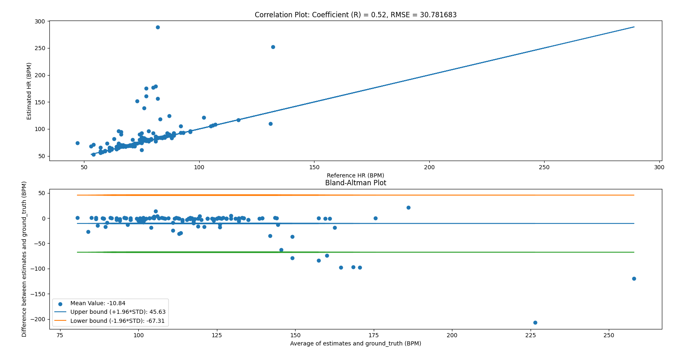
> In this image, we are subplotting the correlation plot to the top and the Bland-Altman plot to the bottom. In the title, one can see the calculated RMSE value.  

At a quick glance, it is easy to see from the correlation plot and the correlation coefficient that the model isn't doing the greatest. This comes from the fact that some predictions ended up predicting double the value of the ground truth value. It is still notable, however, that it did do a great job of predicting a lot of the values. This gives us an initial hunch that maybe some data are worse than others. The Bland-Altman plot provides a similar evaluation with a different visual as the data is now plotted relative to the mean value and an upper and lower bound relative to the standard deviation. Similar conclusions can be made with the BA plot but now it is more obvious which points of data actually drive the model down.

#### Per Subject Difference Evaluation
As we study the results of the model as well as the evaluation methods as shown below, it became apparent that there are inherently some data which perform worse than others. Not only does it result in worse readings, but often its readings are magnitudes away from the ground truth. In order to isolate these pieces of data as well as to visualize what is really happening, we came up with a way to see the difference between ground truths and predictions for each each subject that it is tested on. Here are a few examples of plots and our observations for it. 

Good Data #1           |      Good Data #2     |          Good Data #3 
:-------------------------:|:-------------------------:|:-----------:
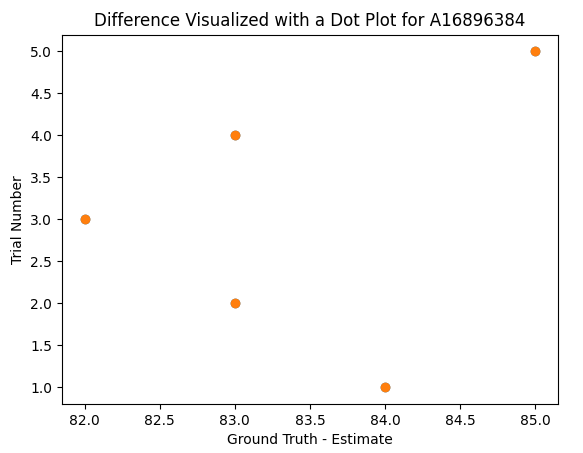 | 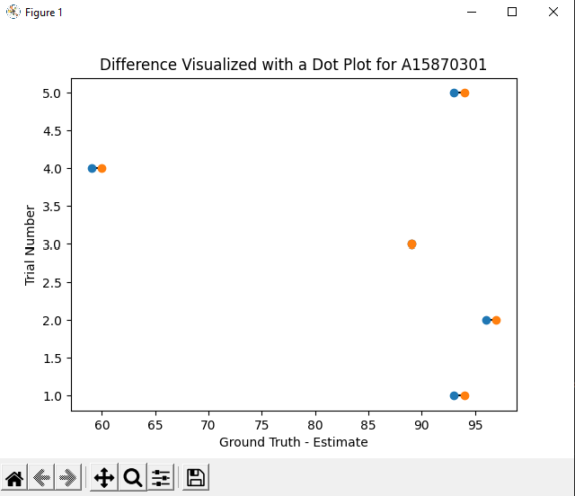| 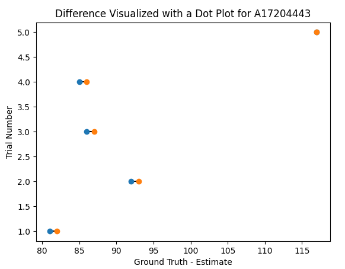

> In these sets of images, one can see that the difference between the predictions made by the model and the ground truth established when the data was created are almost identical, with some even being perfect. These are the data that will be kept as the plots indicate that the data is good.

Bad Data #1           |      Bad Data #2     |          Bad Data #3 
:-------------------------:|:-------------------------:|:-----------:
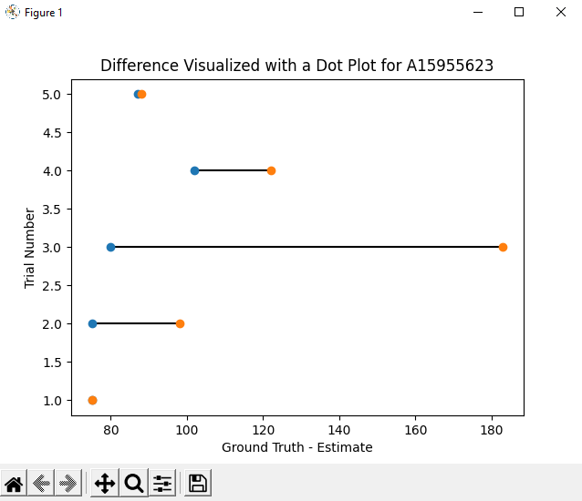 | 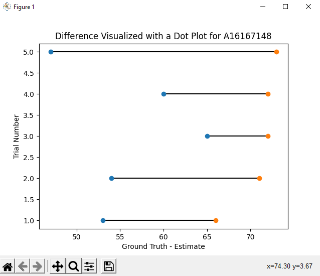| 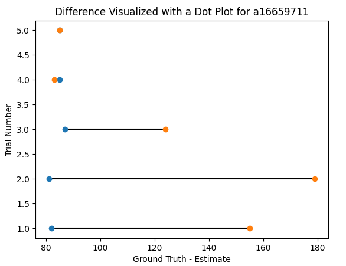

> In these sets of images, it is clear that there are one or more pieces of data which throw the model off and are given predictions that are way more than the ground truth provided by the user. These are the data in which a long line is drawn between the ground truth and the prediction. These data pieces will also be discarded as it can be concluded that these are bad data which throw off the entire model.

Edge Data #1           |      Edge Data #2     |          Edge Data #3 
:-------------------------:|:-------------------------:|:-----------:
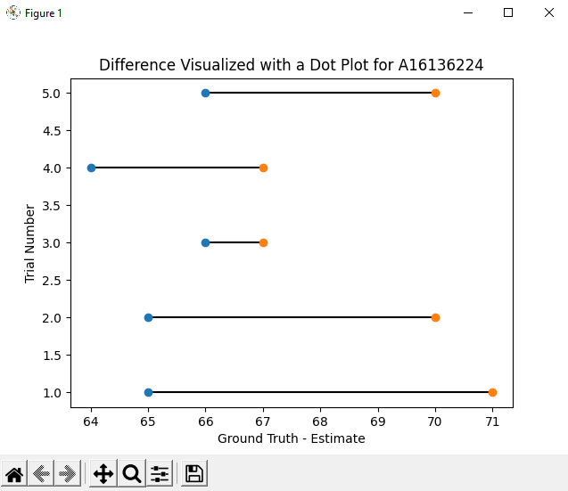 | 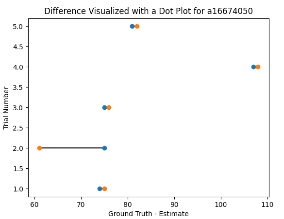| 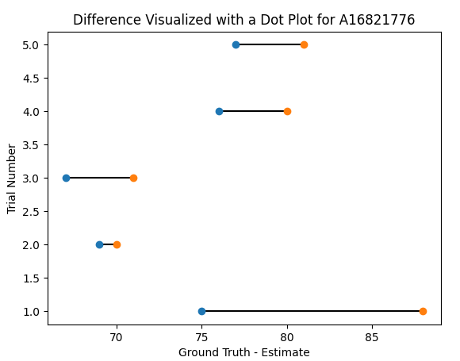

> In these sets of images, the data is relatively good and not as bad as some of the other ones. It is also important to note the scale of the images. Despite there being a long looking line between two points, it is still important to see the value of the difference as some of these may just be zoomed in. With these pieces of data, there is a noticeable error between the ground truth and the predictions but there comes a point in which we decided how much data to discard. For testing purposes, we decided to cut off data whose difference was greater than or equal to 20 in magnitude. 

#### Results of Discarding Some Data
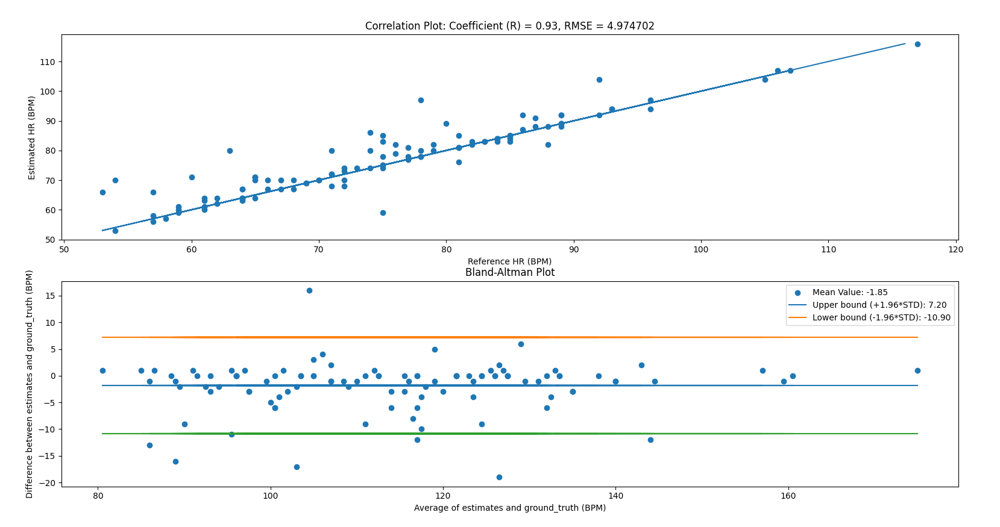
It can now be seen that the RMSE has been reduced significantly, and the correlation increased by a great amount. It is also nice to see the Bland Altman plot showing the values much more tight nit. The removal of deemed "bad data" has drastically improved the quality of the model. 

## Challenge 2: GMM HR Monitor

## Challenge 3: Complete Wearable!
